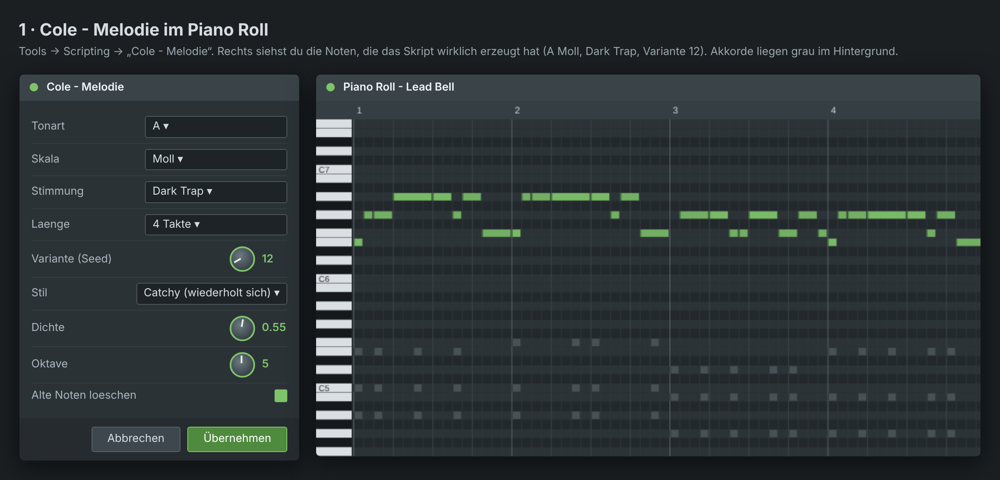
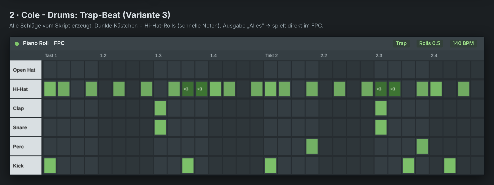
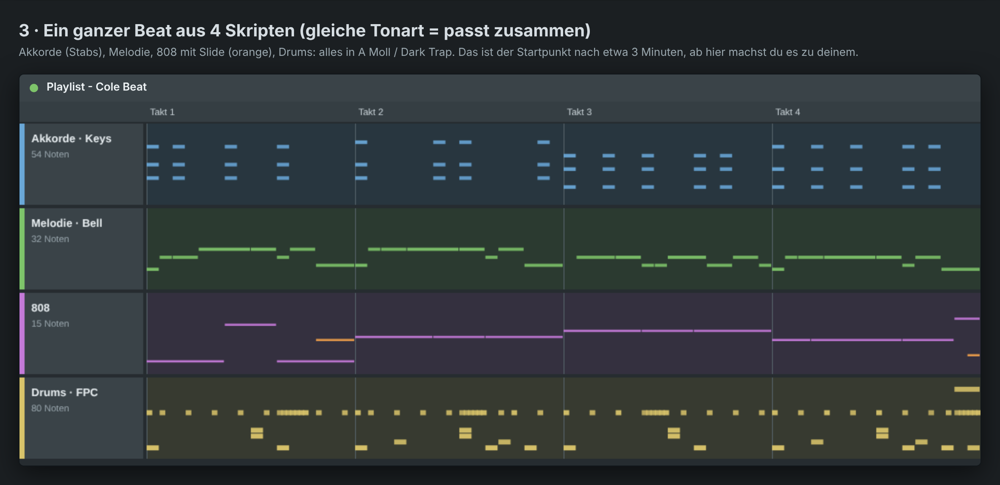
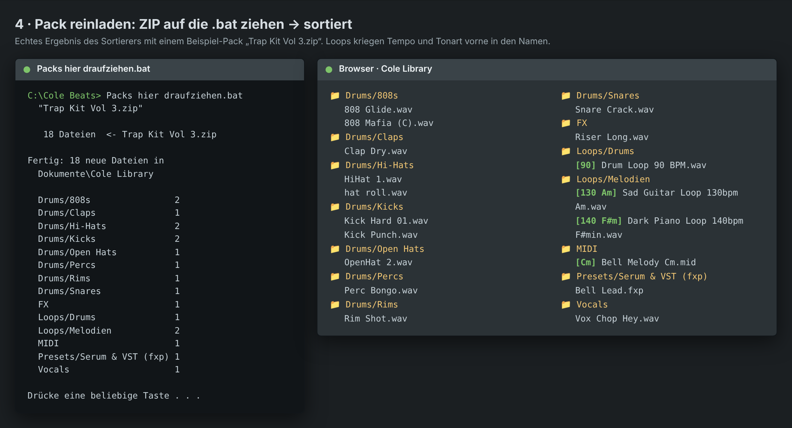

# Cole Beats · FL Studio schnell & einfach

Werkzeugkasten, mit dem du in FL Studio in **5 Minuten** einen Beat hast, oder dir für einen Song so viel Zeit nimmst, wie du willst. Die Generatoren liefern dir nur den Startpunkt. Was daraus wird, entscheidest du: Noten verschieben, löschen, eigene einspielen. So bleibt der Song deiner.

| Teil | Was es macht |
|---|---|
| **6 Piano-Roll-Skripte** | Drums, Akkorde, Melodie, 808, Sample-Chops, Humanize: ein Klick im Piano Roll, Regler drehen, hören, fertig |
| **Pack-Sortierer** | ZIPs/Ordner von Drumkits auf eine Datei ziehen → alles landet sortiert (Kicks, Snares, 808s, Loops mit BPM/Tonart …) |
| **Sound-Suche** | `suche dark 808`, `suche piano --key Am --bpm 140` |
| **Tonart-Helfer** | Zeigt dir, was du in Autotune/Pitcher einstellen musst |
| **Anleitungen** | [Song in 5 Minuten](docs/song-in-5-minuten.md) · [Sampling](docs/sampling.md) · [Autotune](docs/autotune.md) |

Ehrlich gesagt: FL Studio erlaubt keine Mods, die die Oberfläche umbauen. Was offiziell geht, und was das hier nutzt: **Piano-Roll-Skripte** (Python, laufen direkt in FL) plus Hilfsprogramme außerhalb von FL.

## So sieht's aus

Nachgezeichnete Fenster, aber mit den Noten und Ordnern, die die Skripte wirklich erzeugen:






## Einrichten (einmalig, ca. 3 Minuten)

Voraussetzung: FL Studio **21.2 oder neuer** (wegen Piano-Roll-Skripten) und [Python](https://www.python.org/downloads/) (beim Installieren „Add to PATH“ anhaken).

1. Den Ordner `beats` auf deinen PC kopieren.
2. **Doppelklick auf `Installieren.bat`**. Die Skripte landen in `Dokumente/Image-Line/FL Studio/Settings/Piano roll scripts`.
3. Deine Packs: ZIPs oder Ordner **auf `Packs hier draufziehen.bat` ziehen**. Alles wird nach `Dokumente/Cole Library` kopiert (die Originale bleiben, wo sie sind).
4. In FL Studio: *Options → File settings → Browser extra search folders* → `Dokumente/Cole Library` eintragen. Ab jetzt ist alles im Browser links sortiert.

Neue Packs? Wieder auf die .bat ziehen, fertig. Doppelte Dateien werden übersprungen.

## Die Skripte benutzen

Piano Roll öffnen → oben links auf das Menü-Symbol → **Tools → Scripting → „Cole - …“**. Es geht ein Fenster mit Reglern auf; du hörst die Änderung sofort, wenn der Song läuft.

- **Variante (Seed)** ist der wichtigste Regler: Jede Zahl gibt ein anderes Ergebnis. Gefällt dir Variante 37, schreib sie dir auf, dann bekommst du sie jederzeit wieder.
- **Gleiche Tonart + Stimmung** in Akkorde, Melodie und 808 → alles passt automatisch zusammen.
- **Alte Noten löschen** aus = Ergebnis kommt zu deinen Noten dazu.

| Skript | Wofür | Tipp |
|---|---|---|
| Cole - Drums | Trap, Drill, Boom Bap, Afrobeats, Dembow, House, Rage, Lo-Fi | *Ausgabe „Alles“* für FPC. Hast du Kick/Snare/Hats auf eigenen Kanälen: pro Kanal *„Nur Kick“* usw. wählen |
| Cole - Akkorde | 8 Stimmungen (Dark Trap, Sad, Drill, R&B …) | „7er“ klingt voller, „Weit“ für Pads |
| Cole - Melodie | Eingängige Melodie (A-A-B-A-Form) | „Dichte“ runter = weniger Noten, mehr Platz für Vocals |
| Cole - 808 | Bassline auf den Akkord-Grundtönen, mit Slides | Im 808-Sampler Slide/Porta einschalten |
| Cole - Sample Chops | Chop-Muster für Slicex / Fruity Slicer | siehe [Sampling](docs/sampling.md) |
| Cole - Humanize | Timing und Lautstärke leicht variieren | Zum Schluss auf Hats & Keys |

**FPC-Hinweis:** *Drums → „Alles“* nutzt die General-MIDI-Belegung (Kick 36 = C3, Snare 38, Clap 39, Hat 42, Open Hat 46, Perc 37), wie das Standard-FPC-Kit. Wenn bei dir ein Pad anders liegt: im FPC das Pad auf die Note umstellen oder die „Nur …“-Ausgabe nutzen.

## Sounds finden (Kommandozeile, optional)

```
python tools/cole_beats.py suche dark 808
python tools/cole_beats.py suche guitar --key Am --bpm 140
python tools/cole_beats.py suche --kat Snares
python tools/cole_beats.py tonart F#m
python tools/cole_beats.py statistik
```

Loops werden beim Sortieren mit Tempo und Tonart vorne im Namen abgelegt, z. B. `[140 F#m] Dark Piano Loop.wav`. In FLs Browser kannst du also einfach nach `140` oder `F#m` suchen.

## Für Entwickler

- Quellcode der Skripte: `src/` (gemeinsamer Kern in `src/core.py`). Nach Änderungen: `python3 build.py` → `dist/`.
- Tests ohne FL Studio: `python3 -m unittest discover -s beats/tests`
