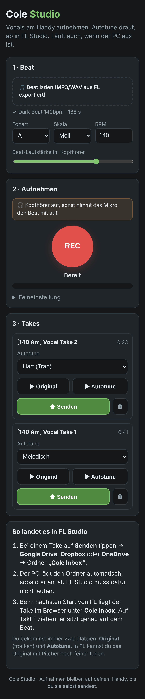

# Cole Studio · Vocals vom Handy, auch wenn FL Studio aus ist



## Die Idee

Das Handy braucht **keinen Server und kein laufendes FL Studio**. Der Weg geht über einen Cloud-Ordner, den du sowieso hast:

```
Handy: Beat hören → Vocals aufnehmen → Autotune → "Senden"
          │
          ▼
Cloud-Ordner "Cole Inbox" (Google Drive / Dropbox / OneDrive)
          │   synchronisiert von selbst, sobald der PC an ist
          ▼
PC: Ordner "Cole Inbox" → steht im FL-Browser → auf Takt 1 ziehen
```

Warum so und nicht mit einem Server, der mit FL verbunden ist? Dann müssten PC und FL immer laufen, und du bräuchtest einen offenen Zugang zu deinem PC aus dem Internet. Der Cloud-Ordner wartet einfach, bis dein PC das nächste Mal an ist. Und FL kann von außen ohnehin keine Audiospuren in ein Projekt legen: Den letzten Schritt (Take in die Playlist ziehen) machst du per Hand, das sind 2 Sekunden.

## Einrichten (einmalig)

**Am PC**
1. Google Drive für Desktop, Dropbox oder OneDrive installieren (falls nicht schon da).
2. Darin einen Ordner **Cole Inbox** anlegen.
3. FL Studio: *Options → File settings → Browser extra search folders* → den Ordner **Cole Inbox** eintragen.

**Am Handy**
1. Die Seite öffnen: `https://moonmaskk.github.io/Cole/studio.html` (falls GitHub Pages für das Repo aktiv ist).
2. Teilen → **Zum Home-Bildschirm**. Dann startet sie wie eine App.
3. Beat aus FL exportieren (MP3) und aufs Handy schicken, z. B. über denselben Cloud-Ordner.

## Benutzen

1. **Beat laden**, Tonart und BPM einstellen. Die Tonart muss die vom Beat sein, sonst tunt Autotune in die falschen Töne. Am PC zeigt `python tools/cole_beats.py tonart Am` die Töne.
2. **Kopfhörer auf**, REC drücken. Nach dem Vorzähler startet der Beat, sing los. STOP.
3. Beim Take das **Autotune** wählen: *Hart (Trap)*, *Melodisch*, *Natürlich* oder *Aus*. Mit ▶ zusammen mit dem Beat anhören.
4. **Senden** → Drive/Dropbox/OneDrive → **Cole Inbox**.

Jeder Take kommt als zwei Dateien: `[140 Am] Vocal Take 3 - Original.wav` und `... - Autotune Hart.wav`. Beide beginnen genau mit dem Beat. In FL also beide auf **Takt 1** ziehen, dann sitzen sie.

## Gut zu wissen

- **Vocals etwas zu spät?** Unter *Feineinstellung → Latenz-Ausgleich* den Regler hochdrehen (jedes Handy ist etwas anders). Einmal einstellen, bleibt gespeichert.
- **Takes bleiben auf dem Handy gespeichert**, auch wenn du die Seite schließt. Gesendet wird nur, was du selbst sendest.
- Das Handy-Autotune ist für schnelle Ideen und den typischen Effekt gedacht. Für den fertigen Song das **Original** in FL mit Pitcher oder Auto-Tune bearbeiten (siehe [Autotune](autotune.md)).
- Ein Handy-Mikro klingt dünner als ein richtiges Mikro. Ruhig aufnehmen, nah ran (ca. eine Handbreit), nicht direkt reinpusten.
